# Career Evidence & Portfolio Coach

A full-stack, AI-assisted career evidence management and portfolio coaching platform for undergraduate Computer Science and Engineering students. Enables students to build authenticated career profiles, record verifiable evidence (projects, certifications, and internships), link evidence to technical skill competencies, curate ordered presentation portfolios, analyze target role gaps, match pasted job descriptions with a multi-tier matrix, and track progress on an interactive career roadmap powered by Google Gemini AI (with a deterministic rule-based fallback).

---

## 📌 Architecture & Technology Stack

- **Frontend:** React 18 with Vite, plain JavaScript (ES Modules), custom dark-theme design system, responsive layout for mobile and desktop viewports.
- **Backend:** Node.js (`>= 20.0.0` LTS) and Express.js with ES Modules (`"type": "module"`). Single-origin architecture where Express serves API endpoints and serves compiled React static assets (`frontend/dist`) with client-side SPA routing.
- **Database & Persistence:** MongoDB Atlas with Mongoose ODM. Enforces strict schema validations, compound unique indexes, relationship integrity, and cascading deletions.
- **Authentication & Security:** JWT tokens delivered via HttpOnly session cookies (for browser sessions) and `Authorization: Bearer` headers (for API clients/Postman). Passwords hashed using `bcryptjs`. Identity ownership strictly enforced (cross-student access returns 403 Forbidden). Rate limiting via `express-rate-limit`.
- **AI Integration:** Official Google Gen AI SDK (`@google/genai`) using structured JSON outputs (`gemini-3.8-flash` with multi-model failover to `gemini-3.5-flash`, `gemini-3-flash-preview`, and `gemini-3.1-flash-lite`), supported by deterministic rule-based fallback engines ensuring 100% functionality offline.
- **Automated Testing & CI:** Node.js native test runner (`node --test`), `mongodb-memory-server` for zero-external-dependency isolated testing (54/54 passing tests), and GitHub Actions CI workflow configuration.

---

## 👥 Fixed Team Module Ownership (10 CSE Students)

1. **N. Tharun Kumar (25071A66B8):** Requirements coordination, educational role catalog, and target role-gap comparison service.
2. **P. Srihith Reddy (25071A66B9):** Express server architecture, environment security, and shared Google Gen AI client integration.
3. **M. Harshavardhan (25071A66B1):** MongoDB Atlas database schema design, Mongoose models, and transactional data consistency.
4. **M. Rohit Sai (25071A66B2):** User profile routes, controllers, and account services.
5. **T. Jaswanth (25071A66D5):** Evidence routes, controllers, and cascading deletion lifecycle services.
6. **J. Sankarshan (25071A6698):** Skill catalog, evidence-to-skill mappings, and AI skill suggestion analysis.
7. **T. Nikhil (25071A66D6):** Portfolio selection, priority ordering, and live assembled preview generator.
8. **R. Suryaprakash (25071A66C5):** Coaching evaluation rules, Gemini coaching prompt engineering, and staleness detection.
9. **P. Sasikanth (25071A66C3):** Shared validators, identity ownership guards, and automated test suite.
10. **K. Bhuvan (25071A66A6):** MongoDB migration scripts, end-to-end smoke tests, Postman collection, and documentation.

---

## 🛠️ System Prerequisites

- **Node.js:** `>= 20.0.0` (LTS). Tested on Node.js `v24.21.0`.
- **npm:** `>= 10.0.0` (bundled with Node.js).
- **MongoDB Atlas:** Free cluster (M0) or local MongoDB instance. (Note: Automated tests run with an isolated in-memory database and do not require Atlas).
- **Google Gemini API Key:** (Optional for live AI calls; obtain from [Google AI Studio](https://aistudio.google.com/)). Rule-based fallbacks operate if unconfigured.

---

## 🚀 Step-by-Step Setup & Installation

Follow these instructions in plain English to set up, build, and run the project locally.

### 1. Install Dependencies
Install dependencies for both the backend Express application and the React frontend:

```bash
# Install backend dependencies (at project root)
npm install

# Install frontend dependencies
npm --prefix frontend install
```

*(Alternatively, running `npm run build` will install frontend dependencies and build the bundle in one step).*

### 2. Configure Environment Variables
Copy `.env.example` to create your local `.env` configuration file:

```bash
# On Windows (PowerShell):
Copy-Item .env.example .env

# On macOS / Linux:
cp .env.example .env
```

Open `.env` and configure your settings:
- `PORT`: Server port (default: `3000`).
- `MONGODB_URI`: Your MongoDB Atlas connection string (see setup guide below).
- `JWT_SECRET`: Random string of 32+ characters for signing student authentication tokens.
- `COOKIE_SECRET`: Random string of 32+ characters for signing HttpOnly cookies.
- `GEMINI_API_KEY`: Your Google Gemini API key (optional; system falls back to rule engines if omitted).
- `AI_MODEL`: Desired Gemini model (default: `gemini-3.8-flash`).
- `AI_TIMEOUT_MS`: Timeout for AI calls in milliseconds (default: `60000`).

> [!SECURITY NOTE]
> Never commit `.env` or real API credentials to Git. The project `.gitignore` files at both root and frontend strictly exclude all real `.env` files while allowing `.env.example`.

### 3. Set Up MongoDB Atlas
1. Log in to [MongoDB Atlas](https://www.mongodb.com/cloud/atlas) and create an **M0 Free Tier** cluster.
2. In **Database Access**, create a database user with password authentication and `Read and write to any database` permissions.
3. In **Network Access**, add an IP entry:
   - For local development: Click **Add Current IP Address**.
   - For cloud hosting: Add `0.0.0.0/0` (allow from anywhere).
4. In **Clusters**, click **Connect** -> **Drivers** (Node.js) -> copy the URI.
5. In `.env`, set `MONGODB_URI` to this connection string, replacing `<username>` and `<password>` with your database user credentials.

*(Optional migration: If migrating legacy JSON data from `data/store.json`, run `npm run migrate:dry-run` to inspect and `npm run migrate` to execute).*

### 4. Build the Frontend
Compile the React single-page application into production static assets:

```bash
npm run build:frontend
```
This generates the optimized bundle in `frontend/dist`.

### 5. Start the Application

#### Option A: Unified Production Mode (Recommended)
Starts the Express server which serves both the API endpoints and the compiled React frontend from a single port:

```bash
npm start
```
Open your browser at `http://localhost:3000`.

#### Option B: Split Development Mode
For live frontend hot-reloading during development:

```bash
# Terminal 1: Backend with automatic restart on changes
npm run dev

# Terminal 2: Vite React development server with HMR
npm --prefix frontend run dev
```
Open your browser at `http://localhost:5173` (API requests are automatically proxied to port 3000).

### 6. Run Tests & Audits

#### Automated Test Suite
Run the 54 automated tests verifying authentication, authorization, evidence cascading, job match normalization, AI fallbacks, and storage integrity:

```bash
npm test
```
*Note: All database tests run exclusively on an ephemeral in-memory database (`mongodb-memory-server`) and will never modify your cloud Atlas data.*

#### Verify Gemini AI Connectivity
```bash
npm run check-ai
```

#### Dependency Vulnerability Audits
```bash
# Audit backend root dependencies
npm audit

# Audit frontend dependencies
npm --prefix frontend audit
```

---

## 📸 Screenshots

The following screenshots demonstrate the application features using sample student data:

### 1. Dashboard
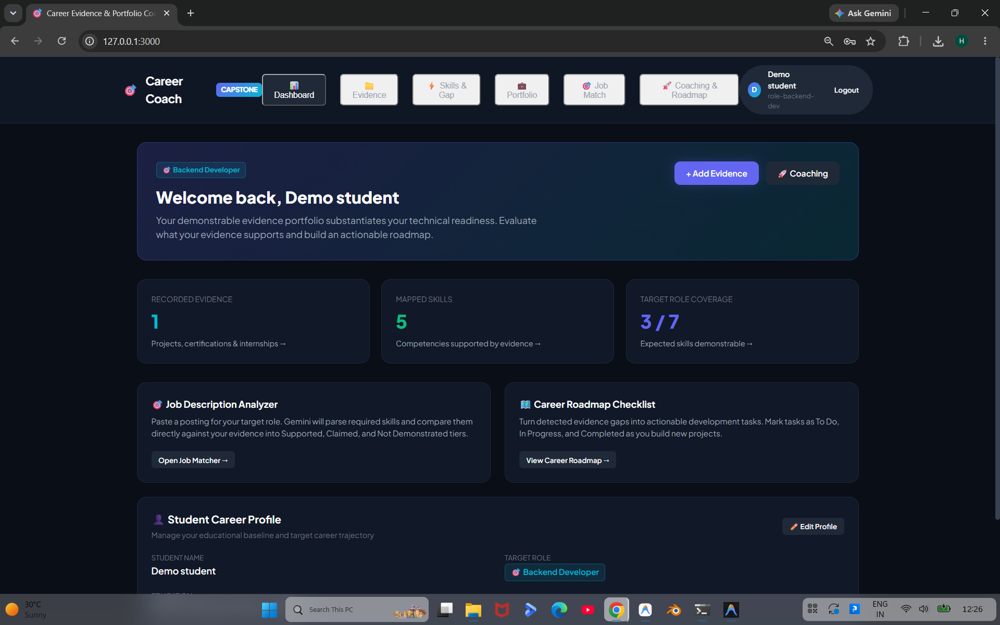
*Demonstration of the student dashboard showing overview metrics, target role selection, and navigation using sample data.*

### 2. Saved Evidence
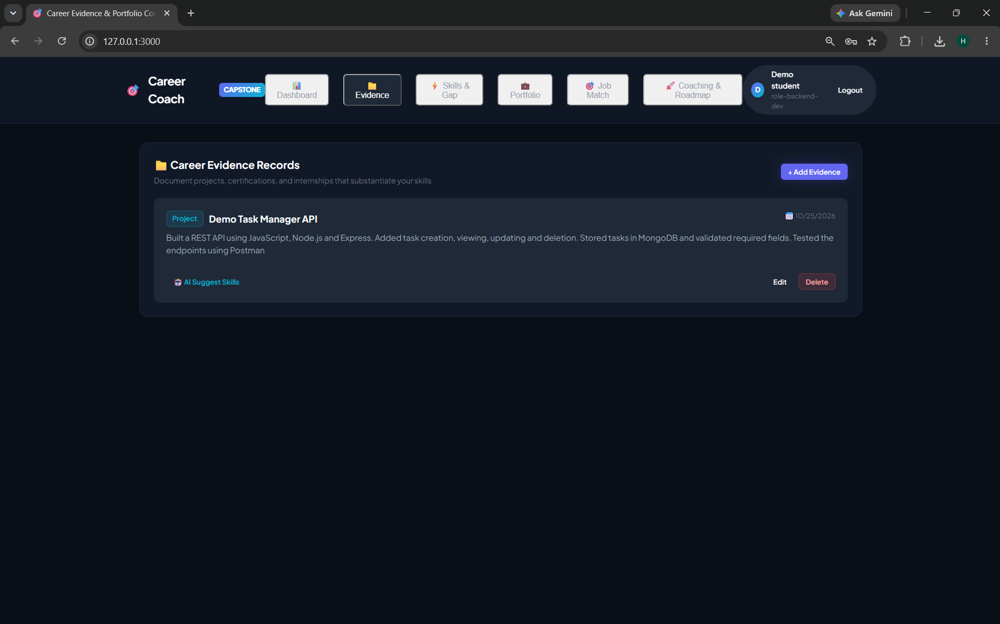
*Demonstration of evidence management records (projects, certifications, internships) with URLs and descriptions using sample data.*

### 3. AI Skill Suggestions
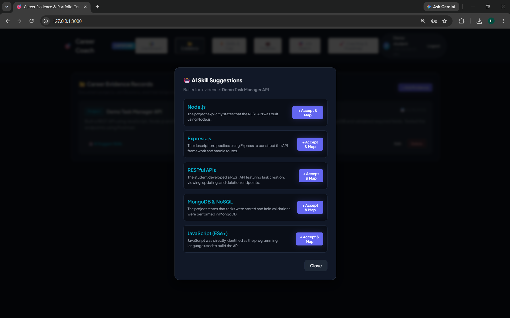
*Demonstration of Google Gemini AI analyzing project evidence to suggest relevant technical skills with justification rationale.*

### 4. Target-Role Skill Gaps
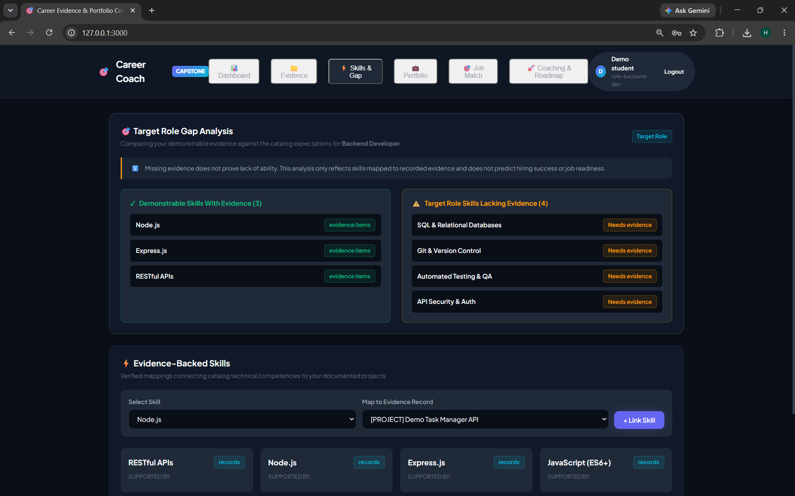
*Demonstration of target role comparison showing demonstrated skills versus missing capabilities.*

### 5. Portfolio Preview
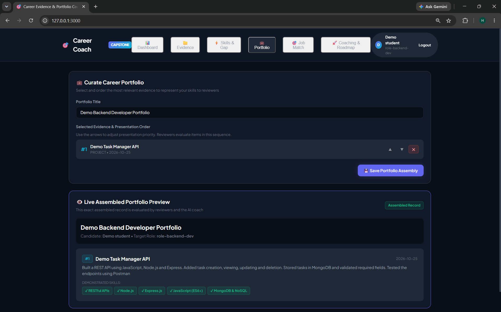
*Demonstration of the curated student presentation portfolio with ordered evidence items and verified skill badges.*

### 6. Job Match Analysis
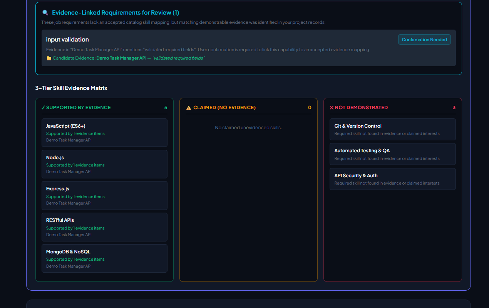
*Demonstration of the job description analyzer matching extracted requirements against evidence-backed skills with review items and genuine gaps.*

### 7. AI Coaching
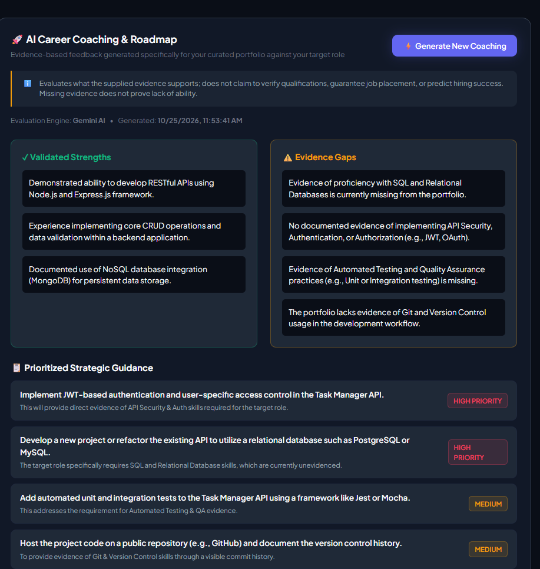
*Demonstration of AI coaching feedback providing strengths, growth areas, and recommendations grounded in student evidence.*

### 8. Career Roadmap
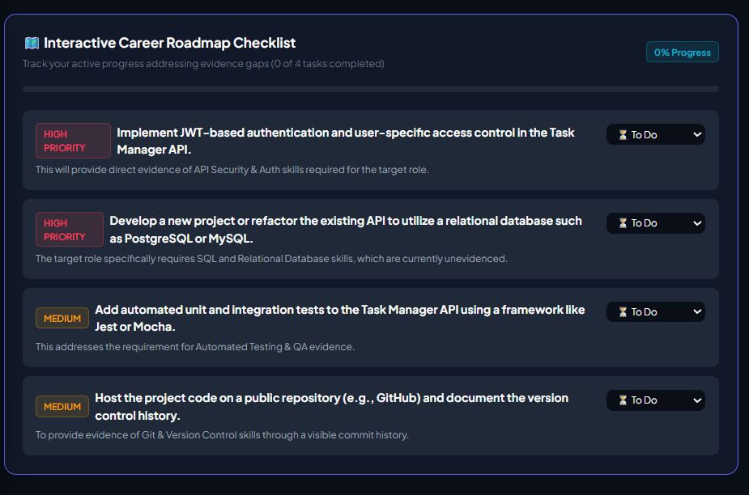
*Demonstration of the interactive career milestone roadmap with actionable tasks and progress status toggling.*

### 9. Automated Test Results
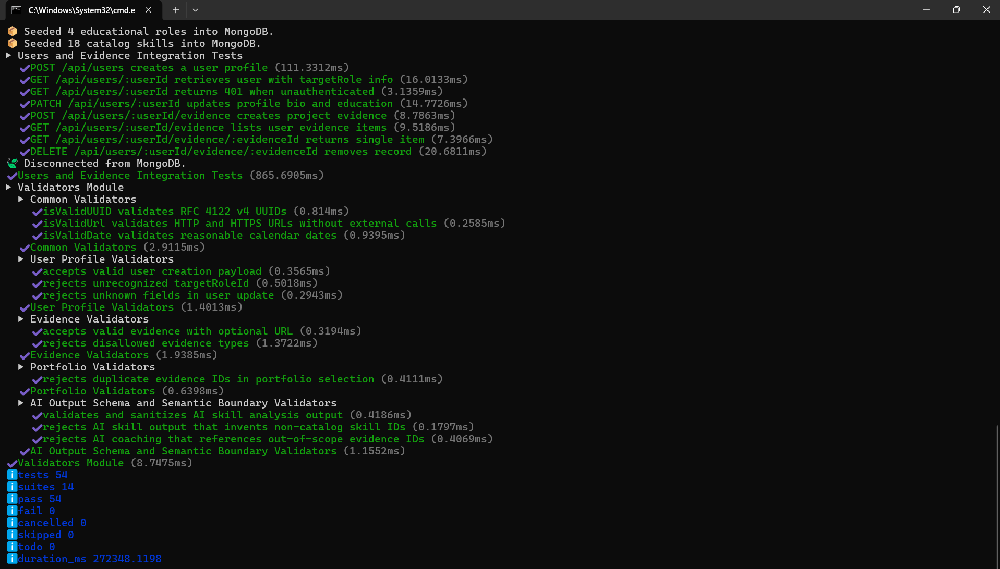
*Execution of the automated test suite demonstrating 54 passing tests across 14 suites using in-memory MongoDB (`mongodb-memory-server`).*

### 10. Dependency Audit
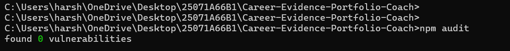
*Root dependency vulnerability audit report via `npm audit` demonstrating 0 vulnerabilities.*

---

### GitHub Actions CI Verification

GitHub Actions successfully installed dependencies, built the frontend,
and ran the automated tests on Node.js 20 and 22.

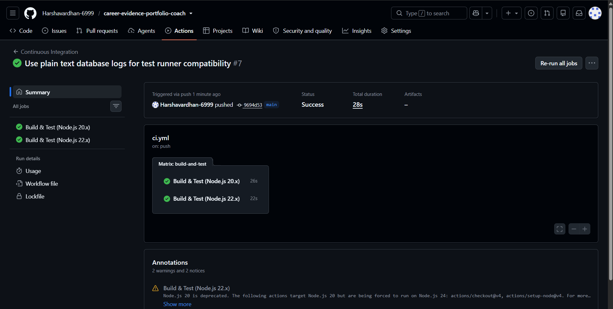

## 🧪 Automated Test Coverage Summary

The automated test suite (`npm test`) executes natively using `node --test` with total database isolation.

- **Total Test Suites:** 14 suites
- **Total Tests:** 54 passed, 0 failed, 0 skipped
- **Test Suites Breakdown:**
  1. `tests/auth.test.js`: Registration, password hashing, login, session tokens, HttpOnly cookies, and strict student identity isolation (Student A cannot read or modify Student B's data - 403 Forbidden).
  2. `tests/jobDescription.test.js`: Raw JD parsing, canonical skill normalization with controlled alias dictionary (`CONTROLLED_SKILL_ALIASES`), candidate review suggestion for unmapped capabilities, and 3-tier gap matrix classification.
  3. `tests/roadmap.test.js`: Dynamic career roadmap task status updates (`todo`, `in_progress`, `completed`).
  4. `tests/usersAndEvidence.test.js`: Profile CRUD, target role assignment, evidence item management, and ownership protection.
  5. `tests/skillsAndPortfolio.test.js`: Skill mappings, duplicate prevention, priority ordering, and cascade deletion.
  6. `tests/coachingAndAi.test.js`: Gemini AI coaching generation, fallback to rule engines, input staleness tracking, and 60000ms timeout handling.
  7. `tests/concurrency.test.js`: Concurrent write operations without lost updates.
  8. `tests/store.test.js`: Fallback JSON store integrity, atomic writes, corruption resilience, and deadlock recovery.
  9. `tests/validators.test.js`: Input schemas, UUIDs, URLs, dates, evidence schemas, portfolio duplicates, and semantic boundaries.

---

## 🛡️ Dependency Vulnerability Audits

- **Root Backend Audit (`npm audit`):** 0 vulnerabilities found across 277 scanned packages.
- **Frontend Audit (`npm --prefix frontend audit`):** 0 vulnerabilities found across 61 scanned packages.

---

## 🌐 Cloud Deployment Guide (Single-Origin)

The application is engineered for zero-CORS, single-origin cloud deployment on platforms like Render, Railway, or Fly.io:

1. **Build Command:** `npm run build` (runs `npm --prefix frontend install && npm --prefix frontend run build`).
2. **Start Command:** `npm start` (runs `node server.js`).
3. **Environment Variables on Cloud Host:**
   - `NODE_ENV=production`
   - `PORT=3000`
   - `MONGODB_URI=<your-mongodb-atlas-uri>`
   - `JWT_SECRET=<secure-random-32-char-string>`
   - `COOKIE_SECRET=<secure-random-32-char-string>`
   - `GEMINI_API_KEY=<your-google-ai-key>`
   - `AI_MODEL=gemini-3.8-flash`
   - `AI_TIMEOUT_MS=60000`

---

## ⚖️ Educational & Ethical Disclaimer

> [!IMPORTANT]
> **Mandatory Platform Policy:**
> This platform strictly evaluates what the student's supplied evidence records substantiate. Missing evidence does not prove a lack of technical ability. The system does not claim to verify credentials, calculate hiring probability scores, or predict employment outcomes.
