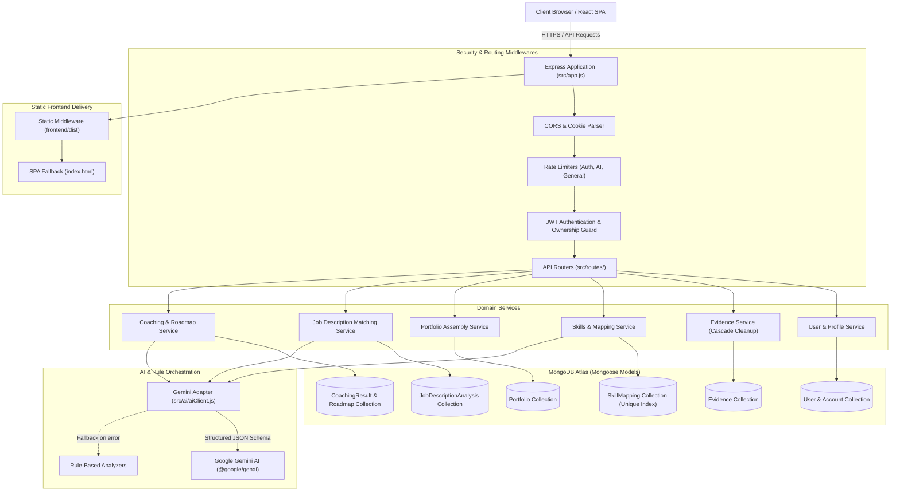

# Architectural Design & Technical Specification

This document details the architectural principles, data flow, persistence model, security boundaries, and AI safety mechanisms of the **Career Evidence & Portfolio Coach** platform.

---

## 1. High-Level System Architecture

The platform follows a modern, decoupled layered architecture featuring a single-origin deployment model:
- **Frontend Layer:** React 18 single-page application built with Vite and modular CSS.
- **API & Middleware Layer:** Express 4 server providing rate-limiting, JWT authentication, cookie extraction, request logging, and static frontend asset delivery.
- **Domain Service Layer:** Pure business logic modules coordinating evidence management, skill normalization, role-gap calculation, and coaching evaluation.
- **Persistence Layer:** MongoDB Atlas via Mongoose ODM, utilizing compound unique indexing, referential integrity guards, and cascade deletion.
- **AI & Safety Layer:** Google Gen AI SDK (`gemini-2.5-flash`) with structured JSON schema outputs and graceful fallback to deterministic rule engines.



---

## 2. Authentication & Authorization Architecture

### Dual-Token Extraction
Incoming requests can provide credentials via either:
1. **HttpOnly Session Cookies:** Set on `Set-Cookie: token=<jwt>; HttpOnly; SameSite=Lax; Max-Age=7d`. Protects credentials from clientside XSS attacks.
2. **Authorization Headers:** `Authorization: Bearer <jwt>`. Enables API automation, Postman testing, and mobile clients.

### Strict Identity Ownership
- Routes under `/api/users/:userId/*` apply the `requireOwnership('userId')` middleware.
- If `req.user.id !== req.params.userId` (and user is not admin), the request is immediately rejected with HTTP 403 `FORBIDDEN`.
- Prevents cross-student access, modifications, or data exfiltration.

---

## 3. MongoDB Schema & Relationship Consistency

### Collections and Models:
- **`User`**: Student account credentials (`passwordHash` excluded by default from queries), profile metadata, educational target role, technical interests, and optional `legacyId`.
- **`Evidence`**: Verified projects, certifications, and internships. Indexed by `userId` and `createdAt`.
- **`Skill` & `Role`**: Static educational catalogs auto-seeded from `data/*.json` on database connection if empty.
- **`SkillMapping`**: Links catalog skills to evidence records. Enforces a compound unique index:
  ```javascript
  skillMappingSchema.index({ userId: 1, skillId: 1, evidenceId: 1 }, { unique: true });
  ```
- **`Portfolio`**: Curated selection of evidence records per user, preserving explicit presentation order.
- **`JobDescriptionAnalysis`**: Stores extracted role requirements and 3-tier skill gap matrix.
- **`CoachingResult`**: Stores AI or rule-based strengths, evidence gaps, prioritized next steps, and interactive roadmap checklist items (`todo`, `in_progress`, `completed`).

### Cascading Deletion Strategy:
When an evidence record is deleted via `DELETE /api/users/:userId/evidence/:evidenceId`:
1. The evidence document is removed from `Evidence`.
2. All associated `SkillMapping` records referencing that `evidenceId` are deleted.
3. Any `Portfolio` records containing `evidenceId` in `selectedEvidenceIds` have the ID filtered out.
4. If a previously generated `CoachingResult` relied on that evidence, its `isStale` flag is triggered on next query.

---

## 4. 3-Tier Job Description Analysis Engine

When raw job descriptions are submitted:
1. **Extraction:** Gemini AI extracts role title, required skills, preferred skills, and general qualifications using strict JSON schema output. If unconfigured or offline, a deterministic keyword pattern extractor runs.
2. **Normalization & Synonym Resolution:** Extracted terms are matched against catalog skills using an industry synonym dictionary (`SYNONYM_MAP`), exact matching, and substring inclusion.
3. **3-Tier Classification:**
   - **Supported by Evidence:** The skill matches a catalog skill mapped to an active evidence item.
   - **Claimed without Evidence:** The skill matches a technical interest declared on the student profile, but no evidence record is linked.
   - **Not Demonstrated:** The skill is required but absent from both evidence mappings and profile interests.
4. **Mandatory Educational Disclaimer:** Explicitly attached to every analysis payload:
   *"Missing evidence does not prove lack of ability. This analysis only reflects skills mapped to recorded evidence and does not predict hiring success or job readiness."*

---

## 5. Dynamic Input Staleness Detection

Coaching evaluations snapshot the exact input state at generation time (`targetRoleId`, `selectedEvidenceIds`, `mappedSkillIds`). On subsequent retrieval (`GET /api/users/:userId/coaching/latest`):
- If `targetRoleId` has changed, `isStale: true` is returned with reason `"Target role changed"`.
- If portfolio evidence selection or order changed, `isStale: true` is returned.
- If skill mappings on portfolio evidence were added or deleted, `isStale: true` is returned.
The UI immediately renders an amber warning banner offering 1-click re-generation.
